<div align="center">

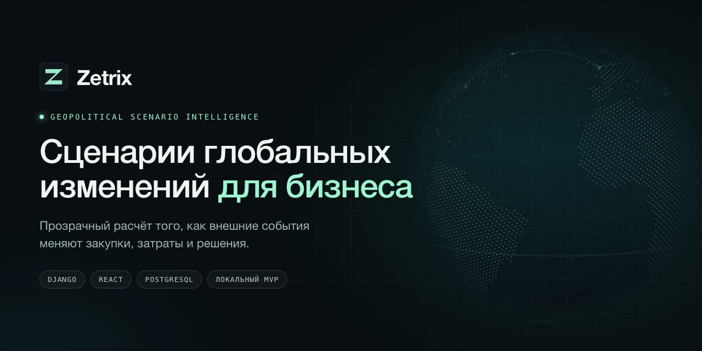

<br>

[](https://github.com/deuteriumZzz/Zetrix/actions/workflows/ci.yml)


**Прозрачный расчёт того, как внешние события меняют закупки, затраты и решения.**

[Возможности](#возможности) · [Скриншоты](#скриншоты) · [Как это считается](#как-это-считается) · [Быстрый старт](#быстрый-старт) · [Архитектура](#архитектура) · [Статус](#статус-и-границы) · [Дорожная карта](#дорожная-карта)

</div>

<p align="center">
  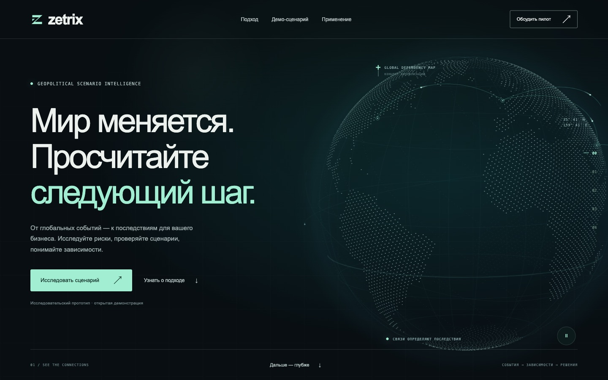
</p>

## О проекте

Zetrix — платформа сценарного анализа геополитических рисков и их последствий
для бизнеса. Первое применение — торговые ограничения и зависимость затрат
компаний с международными закупками.

Команда задаёт портфель закупок, выбирает событие, меняет допущения и получает
воспроизводимый расчёт: что изменится в затратах, по каким строкам и на чём
основан вывод. Помочь ответить на вопрос:
**«Как заданное внешнее событие изменит наши затраты, зависимости и варианты действий?»**

> **Состояние на 31 октября 2026 года: локальный MVP.** Публичного сервиса,
> клиентов и проверенного набора внешних данных пока нет. Что проверено, а что
> нет, — в разделе [Статус и границы](#статус-и-границы).

## Возможности

| | |
| --- | --- |
| **Лендинг и демо** | Русскоязычная страница, глобус из частиц на Canvas2D (вращение, перетаскивание, пауза), интерактивный калькулятор с тремя сценариями, экспорт JSON сценария и пилотного брифа |
| **Кабинет `/app`** | Вход по сессии, организации и роли (owner, admin, analyst, viewer), проекты, неизменяемые версии портфеля и сценариев |
| **Портфель закупок** | Ручной ввод или CSV с предпросмотром и подтверждением версии; выбор затронутых строк |
| **Расчёт** | Детерминированная Decimal-формула, влияние по строкам портфеля, идемпотентный запуск; сохраняются вводные, версия движка и допущения |
| **События и источники** | Реестр источников и событий: черновик → публикация редактором → отзыв; сценарий закрепляет опубликованную версию события |
| **Сравнение и решения** | Сравнение 2–3 расчётов, запись решения со снимком результатов, экспорт JSON и CSV, печать |
| **Надёжность** | Изоляция организаций, CSRF, блокировка организации при записи, идемпотентность, таймауты PostgreSQL с ответом 503 `busy` |
| **Доступность и motion** | Клавиатурные вкладки, адаптивная вёрстка, учёт reduced motion, общая пауза анимаций |

## Скриншоты

Данные на скриншотах демонстрационные: поставщики, суммы и событие вымышлены.

<table>
  <tr>
    <td width="50%">
      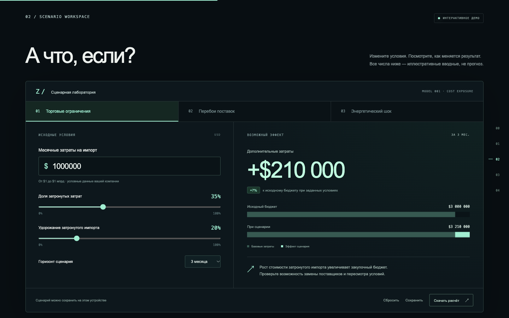
      <br><sub><b>Демо-калькулятор.</b> Три сценария и одна открытая формула</sub>
    </td>
    <td width="50%">
      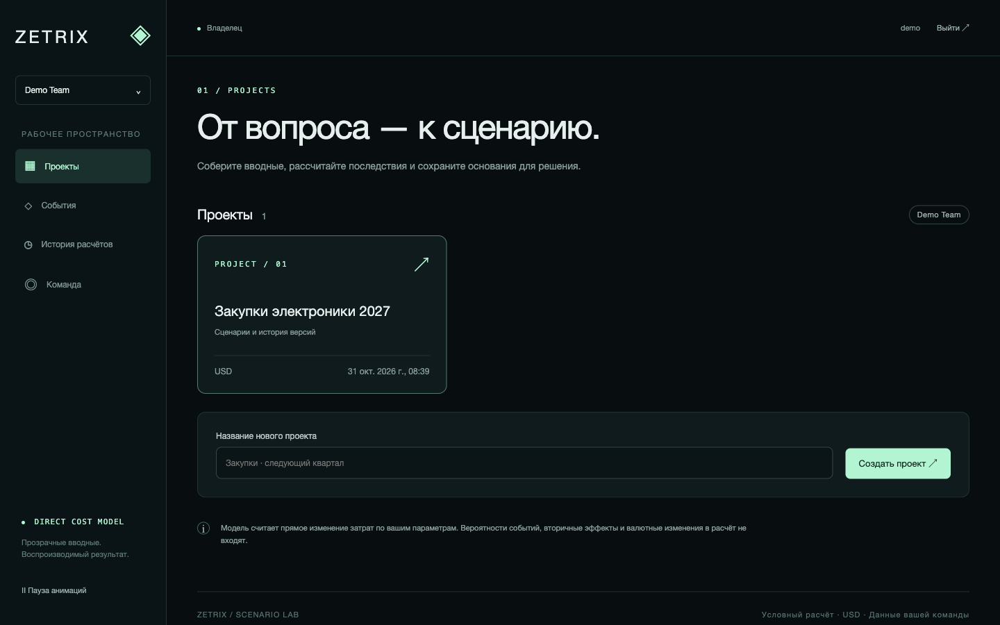
      <br><sub><b>Кабинет.</b> Организации и проекты</sub>
    </td>
  </tr>
  <tr>
    <td width="50%">
      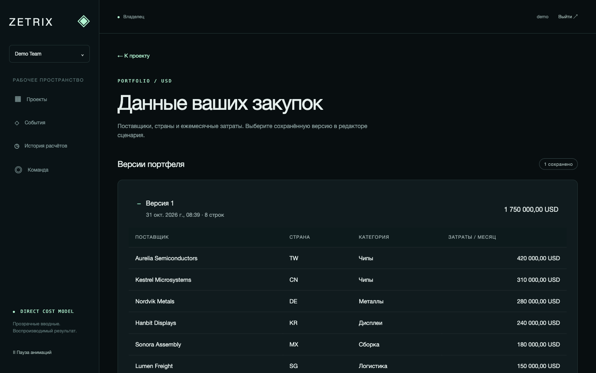
      <br><sub><b>Портфель закупок.</b> Неизменяемые версии, CSV с предпросмотром</sub>
    </td>
    <td width="50%">
      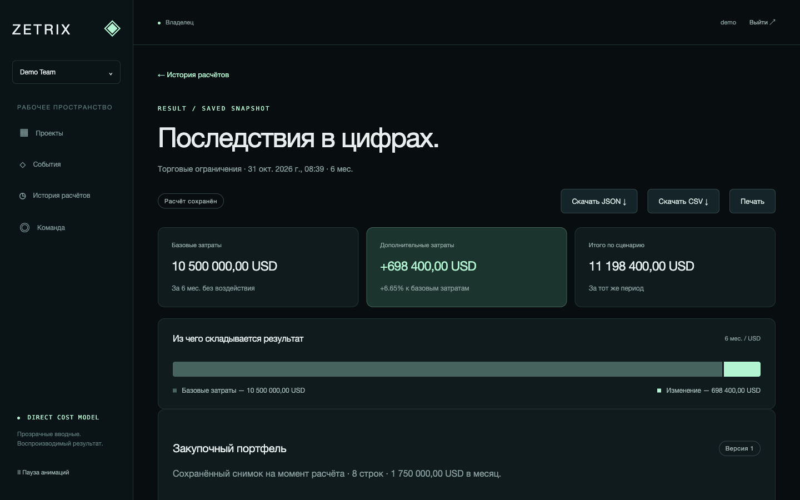
      <br><sub><b>Результат.</b> Базовые затраты, прирост и итог; JSON, CSV, печать</sub>
    </td>
  </tr>
  <tr>
    <td width="50%">
      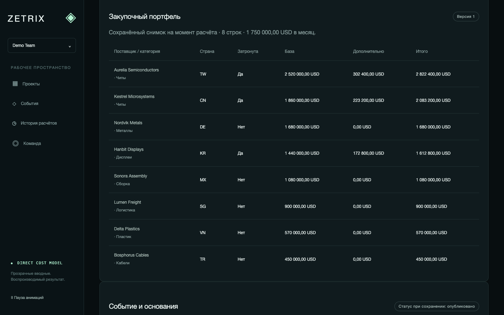
      <br><sub><b>Влияние по строкам.</b> Видно, где именно растут затраты</sub>
    </td>
    <td width="50%">
      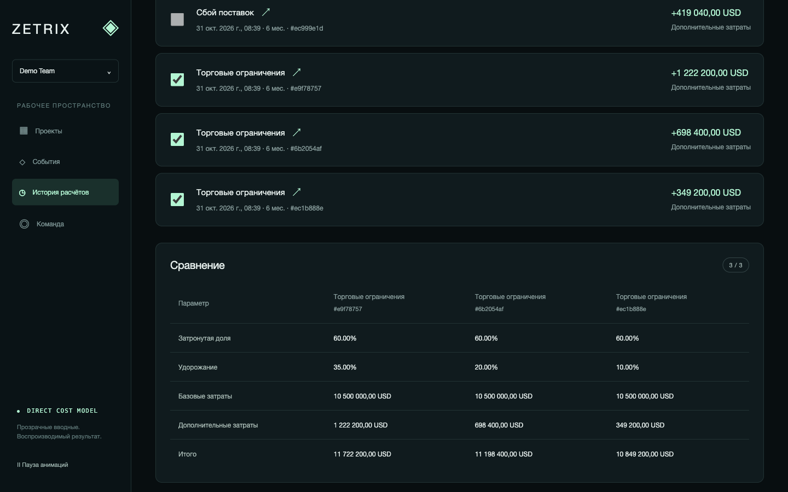
      <br><sub><b>Сравнение.</b> Два-три расчёта с одинаковой базой и горизонтом</sub>
    </td>
  </tr>
  <tr>
    <td width="50%">
      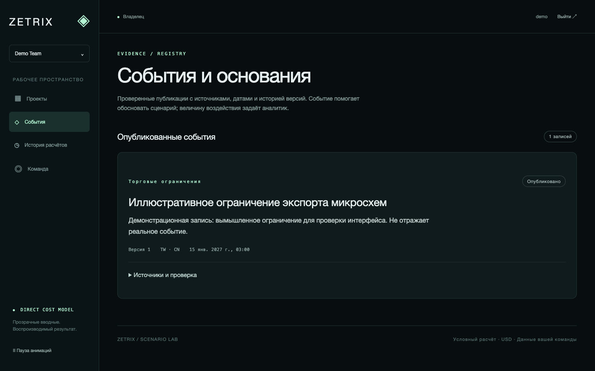
      <br><sub><b>События и основания.</b> Версии, источники и проверка куратором</sub>
    </td>
    <td width="50%" align="center">
      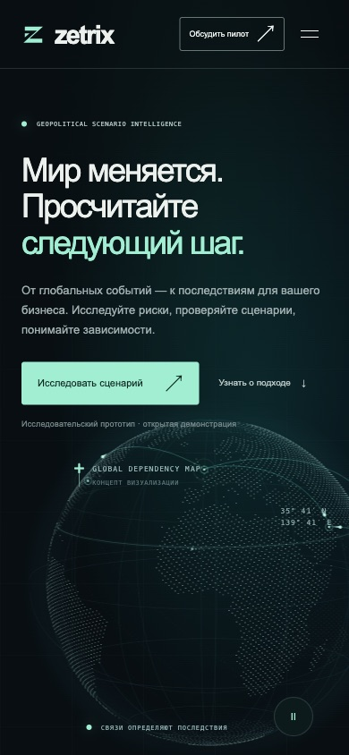
      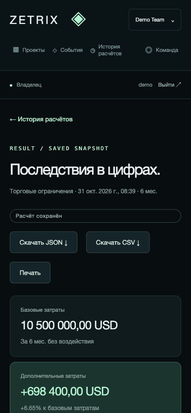
      <br><sub><b>Мобильные экраны</b> (390 px)</sub>
    </td>
  </tr>
</table>

## Как это считается

Одна открытая формула прямого изменения затрат; все параметры задаёт пользователь:

```text
Дополнительные затраты = затраты в месяц × доля затронутых затрат / 100
                       × удорожание / 100 × число месяцев
```

В кабинете «затраты в месяц» — сумма выбранных строк портфеля. Пример
со скриншотов: (420 000 + 310 000 + 240 000) × 60 % × 20 % × 6 мес = **698 400 USD**.

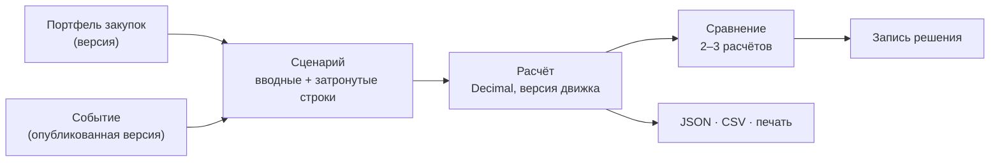

**Границы модели.** Она предполагает постоянные объёмы и условия и не оценивает
вероятность события, валютные изменения, реакцию спроса, запасы и вторичные
последствия. Три типа сценариев пока используют одну формулу, а не три
независимые модели. Глобус и линии на нём визуализируют концепцию, а не реальные
потоки торговли, текущие события или результаты моделирования.

Принципы: каждый вывод раскрывает вводные, источники и допущения; вероятность
события и величина последствий — разные величины; иллюстративный расчёт не
называется прогнозом или доказанной симуляцией.

## Быстрый старт

Нужны Node.js и, для кабинета, Python 3.11.

**Только лендинг** (без backend, Docker и ключей):

```sh
cd frontend
npm install
npm run dev -- --host 127.0.0.1 --port 5173
```

Открыть <http://127.0.0.1:5173/>.

**Кабинет с backend** — локальный профиль `workspace_local` на одноразовой SQLite,
только для loopback-разработки:

```sh
python3.11 -m venv .venv-mvp
.venv-mvp/bin/python -m pip install -r requirements/mvp.txt

export DJANGO_SETTINGS_MODULE=config.settings.workspace_local
export ZETRIX_LOCAL_DB=/tmp/zetrix-local.sqlite3
.venv-mvp/bin/python -m django migrate
.venv-mvp/bin/python -m django createsuperuser   # staff-пользователь может публиковать события
.venv-mvp/bin/python -m django runserver 127.0.0.1:8000
```

Во втором терминале запустить frontend командой выше и открыть
<http://127.0.0.1:5173/app>: Vite проксирует `/api` на `127.0.0.1:8000`.
Профиль для пилота, переменные окружения и PostgreSQL — в [BACKEND.md](docs/BACKEND.md).

**Проверки:**

```sh
.venv-mvp/bin/python -m django test apps.workspaces apps.scenario_engine apps.evidence apps.decisions \
  --settings=config.settings.workspace_test
cd frontend && npm test && npm run build
```

Тесты гонок и проверка на PostgreSQL описаны в [BACKEND.md](docs/BACKEND.md).

## Архитектура

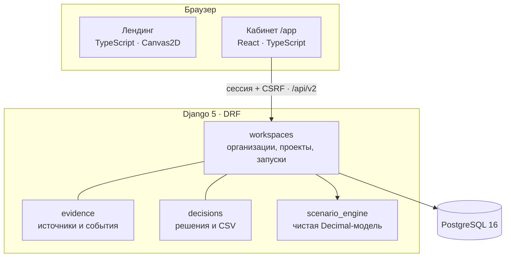

| Слой | Технологии |
| --- | --- |
| Лендинг | TypeScript, Vite, Canvas2D |
| Кабинет | React 18, TypeScript, React Router |
| API | Django 5.0, Django REST Framework 3.15, сессии и CSRF |
| Данные | PostgreSQL 16 как целевая БД; SQLite только для локальной разработки и тестов |
| Расчёт | `apps/scenario_engine` — чистая Decimal-модель без зависимости от UI |
| Тесты | Django test runner, Vitest; гонки — отдельный набор на PostgreSQL |
| CI | GitHub Actions: job `backend-v2` (миграции, SQLite, PostgreSQL 16 с гонками) и прежний job `backend` |

```text
frontend/index.html, src/zetrix/   Лендинг
frontend/app/, src/cabinet/        Кабинет /app
apps/workspaces/                   Организации, проекты, портфель, запуски
apps/evidence/                     Источники и события
apps/decisions/                    Записи решений и CSV-экспорт
apps/scenario_engine/              Модель прямого изменения затрат
config/settings/                   Профили: mvp, workspace_local, workspace_test, workspace_pg_test
docs/                              Спецификация, backend, план развития
```

Остальные каталоги `apps/` и `frontend/src/pages/` — сохранённый код прежнего
продукта Global Opportunity Explorer ([архив описания](docs/legacy-opportunity-explorer.md)).
Новый MVP изолирован от него настройками `config.settings.mvp`.

## Статус и границы

| | |
| --- | --- |
| **Проверено локально** | Сборка frontend и 76 frontend-тестов; 66 backend-тестов на SQLite и PostgreSQL 16.2 и 9 тестов гонок на PostgreSQL. В браузере: вход → организация → проект → портфель → сценарий → запуск → обновление страницы, а также источник → публикация события → выбор в сценарии → запуск |
| **Покрытие** | Кабинет: 87 % инструкций, 80 % ветвей, 81 % функций. Четыре модуля backend v2: 98 % с ветвлениями. Покрытие всего репозитория не измерено |
| **Экспорт и вёрстка** | 31 октября 2026 содержимое и имена четырёх экспортных файлов проверены перехватом в браузере; адаптивность — на 375, 768 и 1440 px во встроенном браузере |
| **Не проверено** | Первый запуск CI на GitHub; Redis и несколько процессов gunicorn; PgBouncer; Safari и Firefox, реальные устройства; сохранение файла на диск и открытие в Excel; полная проверка клавиатурой и screen reader; production-окружение |
| **Нет** | Публичного сервиса, регистрации и приглашений, проверенных внешних источников данных, AI-помощника, вероятностных оценок, симуляции поведения акторов, биллинга |

Лендинг не получает live-данные, не вызывает AI, не отправляет бриф и не создаёт
аккаунты; его сохранение работает через `localStorage`. Кабинет сохраняет данные
на локальном сервере через API. Спрос, цены, точность и готовность клиентов платить
пока не подтверждены.

## Дорожная карта

- [x] Лендинг и демонстрационный расчёт
- [x] Backend v2, кабинет, события, сравнение расчётов и записи решений
- [x] Проверка на PostgreSQL, таймауты и тесты гонок
- [ ] Первый сегмент, интервью и демонстрационный кейс
- [ ] Разрешённые источники данных и проверка их качества
- [ ] Граф зависимостей и несколько моделей воздействия
- [ ] Пилот на реальных данных (после согласования с владельцем проекта)
- [ ] Приглашения, staging, резервное копирование и восстановление

Долгосрочная цель — платформа сценарного моделирования геополитики для решений
организаций; разрыв и путь описаны в [плане, этап H](docs/ROADMAP.md). Пока этого
не подтверждают проверки, Zetrix не называет свой расчёт симуляцией или
AI-прогнозом.

## Документация

- [Спецификация MVP: кабинет, backend, API и этапы](docs/MVP.md)
- [Backend v2: запуск, авторизация и фактические маршруты](docs/BACKEND.md)
- [План развития, ближайшие действия и журнал проверок](docs/ROADMAP.md)
- [Устройство лендинга](frontend/src/zetrix/README.md)
- [Архив описания Global Opportunity Explorer](docs/legacy-opportunity-explorer.md)

Публикацию, внешние сообщения и подключение платных сервисов согласуют с
владельцем проекта отдельно.

## Лицензия

Файл лицензии пока не добавлен, поэтому права на использование кода не предоставлены.
