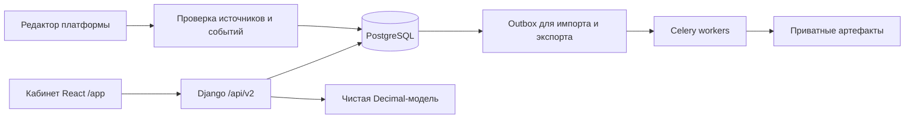

# Zetrix MVP — продукт, личный кабинет и backend

Обновлено: 24 октября 2026. Статус: спецификация первой версии и план дальнейшей реализации.
Документ продолжает [дорожную карту](ROADMAP.md); актуальная точка входа — [README](../README.md).
**Разделы 1–15 описывают целевую версию; фактически реализованное и проверенное
отмечено в разделе 16 и [BACKEND.md](BACKEND.md).**

## 1. Какую задачу решает MVP

Команда международных закупок создаёт проект, описывает затраты и зависимость
от поставок, задаёт внешнее изменение, сравнивает варианты и сохраняет
воспроизводимый отчёт для принятия решения. Первый сценарий — удорожание
импорта вследствие заданных торговых ограничений.

Пример пользовательского вопроса: «При месячных закупках $1 млн, доле
затронутого импорта 35% и удорожании 20% сколько дополнительно потребуется
на три месяца? Какие допущения определяют результат?»
Ответ базовой модели: $210 000 дополнительных затрат. Это условный расчёт;
вероятность введения ограничений в него не входит.

### Кому продаём — гипотеза, требующая интервью

- Пользователь: аналитик закупок или финансового планирования.
- Заказчик: руководитель закупок / финансовый директор.
- Начальный формат: сопровождаемый пилот на одном закупочном портфеле.
- Ценность: единые вводные, несколько сопоставимых сценариев, понятная связь
  результата с параметрами, история версий и отчёт для обсуждения.
- Конкретные отрасль, страна клиентов, бюджет и цена пока не подтверждены.

### Критерий ценности пилота

Пользователь способен самостоятельно воспроизвести расчёт, объяснить отличие
двух сценариев и назвать решение, для которого результат полезен. Фиксируем
время подготовки анализа до/после, долю заполненных данных, число исправлений
аналитика, повторное использование и готовность продолжить платную работу.
Целевые значения согласуем до пилота; посещаемость лендинга не заменяет их.

## 2. Границы первой версии

| Включить в MVP | После MVP |
| --- | --- |
| Вход, организация, роли, изоляция данных | SSO, SCIM, сложные корпоративные политики |
| Проекты и закупочный портфель в USD | Автоматический FX, ERP-коннекторы |
| Ручной ввод и CSV с предпросмотром | Потоковый импорт, автоматическое обогащение |
| Курируемые события и ссылки на источники | Непрерывный мировой новостной поток |
| Версии сценариев, прямой стоимостной эффект | Многоагентная геополитическая симуляция |
| Baseline и сравнение до трёх результатов | Автоматический поиск «лучшей» стратегии |
| История, JSON/CSV и печатный отчёт | Конструктор произвольных отчётов |
| Ручная фиксация решения и допущений | AI-советник с автономными действиями |
| Сопровождаемые пилоты и ручное управление доступом | Автоматический billing и открытый self-service |

Три темы демо могут использовать одну прозрачную модель. В MVP не обещаем
предсказывать войны, доходность активов, вероятность санкций или поведение
государств. Оценка последствий и оценка вероятности — отдельные задачи.

## 3. Сквозной пользовательский путь

1. Пользователь получает доступ к пилоту и входит.
2. Создаёт организацию или принимает приглашение в существующую.
3. Указывает название проекта, валюту USD и период.
4. Вводит затраты вручную либо загружает CSV; исправляет ошибки до подтверждения.
5. Выбирает одобренное событие или создаёт собственное допущение.
6. Настраивает затронутые строки, долю воздействия, удорожание и горизонт.
7. Видит проверку вводных и сохраняет неизменяемую версию сценария.
8. Запускает расчёт, получает baseline, изменение затрат и разбор по строкам.
9. Создаёт альтернативную версию и сравнивает результаты на одном baseline.
10. Записывает решение, выгружает отчёт с версиями, источниками и ограничениями.

Пустой кабинет предлагает создать проект. Отдельный демонстрационный проект
явно помечается и не смешивается с клиентскими данными.

## 4. Личный кабинет: структура и экраны

Кабинет реализован на `/app` как отдельный React/TypeScript entry;
публичный лендинг остаётся на `/`. Локальный Vite обслуживает `/app/*` через
fallback кабинета. Таблица ниже — целевая карта экранов, а не список готовых URL.
Фактические маршруты перечислены в разделе 16.

Общий каркас: слева навигация; сверху организация, проект, поиск и профиль;
в рабочей области содержание; справа контекстная панель источников/допущений.
На мобильном — выдвижное меню и полноэкранная контекстная панель.

| Экран / маршрут | Содержание и основные действия | Состояния и доступ |
| --- | --- | --- |
| Вход `/app/login` | Email/идентификатор, пароль, восстановление доступа | Loading, ошибка без раскрытия существования аккаунта, истёкшая сессия |
| Старт `/app/onboarding` | Создать организацию, первый проект, пример CSV | Нет членства, приглашение истекло, данные не сохранены |
| Обзор `/app` | Последние проекты, сценарии, результаты, незавершённые действия | Без выдуманных KPI; пустое состояние ведёт к созданию проекта |
| Проекты `/app/projects` | Поиск, архив/активные, создание | Viewer читает; analyst создаёт; удаление истории вне MVP |
| Проект `/app/projects/:id` | Контекст, baseline, данные, сценарии, история | Не заполнен, готов к сценарию, данные изменились |
| Портфель `/app/projects/:id/exposure` | Таблица поставщик/страна/категория/затраты; CSV preview | Ошибки по строкам, валюта не поддержана, подтверждение версии |
| События `/app/events` | Курируемая лента, фильтры по региону/типу/дате | Источник недоступен, устарело, нет релевантных событий |
| Карточка события `/app/events/:id` | Что произошло, дата действия, источники, статус проверки | Разделены факт, интерпретация и допущение пользователя |
| Сценарии `/app/projects/:id/scenarios` | Название, тип, версия, автор, последний запуск | Черновик, нет результата, сохранена новая версия |
| Редактор `/app/scenarios/:id` | Baseline → воздействие → допущения → обзор | Валидация до запуска; конфликт версии; предупреждение о несохранённом |
| Результат `/app/runs/:id` | Baseline, delta, итог, строки, формула, источники | Выполняется/готов/ошибка; старые результаты неизменны |
| Сравнение `/app/compare` | До 3 runs: вводные, delta, ограничения, различия | Разные baseline нельзя незаметно сравнивать как равные |
| Отчёты `/app/reports` | Экспорты, автор, дата, версия; JSON/CSV/печать | Подготовка, готов, истёкший файл, ошибка, повтор |
| Команда `/app/settings/team` | Участники, роли, приглашения | Owner/admin управляют; нельзя лишить организацию последнего owner |
| Настройки `/app/settings` | Название организации, профиль, выход | Валюта существующей версии не переписывается |
| Журнал `/app/settings/activity` | Кто изменил данные, создал версию, запустил/export | Доступ согласно роли; без паролей и содержимого секретов |

### Детализация редактора сценария

- Заголовок и цель анализа; проект и закреплённая версия портфеля.
- Тип: торговое удорожание, логистическое удорожание, энергия.
- Источник: одобренное событие либо «моё допущение» с объяснением.
- Область воздействия: весь портфель или выбранные строки.
- Доля затронутых затрат, удорожание, горизонт 1/3/6/12 месяцев.
- Видимая формула и перечень исключённых факторов.
- Сохранить версию; запустить; создать копию; перейти к сравнению.
- Двойной клик по запуску не создаёт два независимых результата.
- Ошибка ввода остаётся рядом с полем; прежний результат имеет явную метку
  «для предыдущей версии», пока новые параметры не рассчитаны.

### Результат и отчёт

Показывать исходную сумму, дополнительные затраты и итог одновременно.
Рядом — валюта, период, дата расчёта, версия модели и версия вводных.
Разбор по строкам должен сходиться с итогом по описанному правилу округления.
Отдельно — источники, пользовательские предположения, ограничения и заметка
аналитика. Экспорт содержит тот же snapshot, что экран, а не текущие изменённые данные.

## 5. Роли и изоляция

| Возможность | Viewer | Analyst | Admin | Owner |
| --- | --- | --- | --- | --- |
| Читать проекты и результаты своей организации | Да | Да | Да | Да |
| Создавать проекты, версии и расчёты | Нет | Да | Да | Да |
| Создавать экспорт | Нет | Да | Да | Да |
| Управлять участниками без owner-привилегий | Нет | Нет | Да | Да |
| Назначать/снимать owner | Нет | Нет | Нет | Да, кроме последнего |
| Управлять оплатой/владением | Нет | Нет | Нет | Да |
| Публиковать общие источники/события | Нет | Нет | Нет | Нет |

Редактор общих данных — отдельная роль сотрудника платформы.
Организация из URL проверяется через действующее членство. Клиент не может
назначить себе `organization_id`, автора, роль или готовый результат через JSON.
Все связанные объекты проверяются на принадлежность одной организации.
Чужой объект отвечает `404`; запрет действия в своей организации — `403`.

## 6. Backend: принятые технические решения

**Архитектурный выбор:** модульный Django/DRF-монолит, PostgreSQL, Celery/Redis
для действительно долгих работ, приватное файловое хранилище. Не требуется
разделение на микросервисы для первого пилота.



- Лёгкий расчёт первой итерации выполняется синхронно в транзакции и возвращает
  готовый run. Не изображать очередь или длительную AI-обработку.
- При появлении тяжёлых моделей контракт запуска меняется версионированно:
  `202` + status URL; queued/running/retry_wait/succeeded/failed/cancelled.
- Для импорта и экспорта: transactional outbox, идемпотентный worker,
  ограниченные retries, lease и восстановление зависших работ.
- Один планировщик задач. Старые Airflow/Beat расписания не включаются автоматически.
- Новый namespace `/api/v2/`; старые API `/api/v1/` не подключать к кабинету.
- Браузерная авторизация: same-origin Django session, HttpOnly cookie, CSRF,
  Secure в production. JWT старого приложения не переносить в localStorage кабинета.
- Обычный polling с backoff достаточен для фоновых задач; WebSocket позже при необходимости.

### Переиспользование существующего кода

| Есть в репозитории | Решение для MVP |
| --- | --- |
| Django/DRF, миграции, инфраструктура PostgreSQL/Redis | Переиспользовать после настройки окружения |
| `apps/users`, auth.User | Переиспользовать идентичность; новый session-flow отделить от старого JWT UI |
| `apps/geo` | Справочник после проверки покрытия; не связывать ядро расчёта с GIS |
| `apps/reports` | Изучить шаблоны; новая принадлежность и snapshots обязательны |
| `apps/sources` | Изучить подход; редакционный доступ и версии нужны заново |
| `apps/billing` | Не подключать старые тарифы автоматически к новой организации |
| `apps/opportunity` | Сохранить legacy; не выдавать за движок сценариев |
| React-страницы `frontend/src/pages` | Сохранённый legacy; новый кабинет живёт отдельно в `frontend/src/cabinet` |

### Ограничения legacy, найденные чтением кода

- `apps/reports/views.py`: глобальный queryset отчётов без фильтра владельца.
- `apps/sources/views.py`: глобальные источники/запуск сбора доступны по общей auth-политике.
- `apps/reports/tasks.py`: переход failed перед retry конфликтует с захватом только pending.
- `config/settings/base.py`: расписание сбора не передаёт обязательный `source_pk`.
- `apps/opportunity/tasks.py`: обновление полей до нового review может менять уже опубликованный профиль.

Это статические находки, не результат проверки production. Перед пилотом
выключить legacy endpoints/расписания в отдельном профиле развёртывания или
исправить их с тестами. Простое добавление `/api/v2/` не устраняет риски `/api/v1/`.

## 7. Модули и модель данных

Для первого рабочего контура новые сущности допускается собрать в
`apps/workspaces`; чистое вычисление — в `apps/scenario_engine`.
При расширении разделять домены по ответственности, а не создавать десятки
пустых Django apps заранее.

| Сущность | Основные поля | Правило |
| --- | --- | --- |
| Organization | UUID, name, currency, created_at | USD первой версии; организация — граница доступа |
| Membership | organization, user, role, active | UNIQUE(org,user), последнего активного owner нельзя убрать |
| Invitation | org, email, token_hash, role, expires_at, accepted_at | Одноразовый токен; raw token не хранится |
| Project | org, title, description, currency, creator | Архивирование сохраняет историю |
| PortfolioRevision | project, number, currency, checksum, creator | После публикации snapshot неизменен |
| ExposureLine | revision, supplier_label, country, category, monthly_cost | Decimal; строки одной валюты |
| Source | publisher, url, allowed_use, retrieved_at, checksum | Ссылка на происхождение и права |
| EventRevision | event, countries, type, dates, evidence, review_status | Одобряется конкретная версия |
| Scenario | org, project, title, creator | Группирует версии одной гипотезы |
| ScenarioRevision | scenario, number, inputs, baseline_ref, assumptions | Append-only; новая правка = новая версия |
| Run | org, revision, model_version, input_hash, status, result | Не пересчитывать историю при чтении |
| Decision | project, run_refs, note, author | Решение человека отдельно от расчёта |
| ExportJob / Artifact | org, run, format, status, private_path, expires_at | Файл не доступен по публичному MEDIA_URL |
| AuditEvent | org, actor, action, object_id, timestamp, safe_metadata | Не хранит пароли/tokens/сырые секреты |
| OutboxMessage | kind, payload_ref, status, attempts, available_at | Повторная доставка безопасна |

Все приватные запросы фильтруются по организации до поиска объекта.
Для каждого endpoint проверяются также вложенные FK; UUID не является защитой.
Ссылки на удаляемого пользователя сохраняют авторство через согласованную retention-политику.

## 8. Расчётный контракт

Начальный вход:

```json
{
  "kind": "trade",
  "monthly_cost": "1000000.00",
  "exposure": "35.00",
  "shock": "20.00",
  "months": 3,
  "currency": "USD"
}
```

- `monthly_cost`: 1..1 000 000 000, до двух знаков после запятой.
- `exposure`, `shock`: 0..100, до двух знаков.
- `months`: строго 1, 3, 6 или 12; `kind`: trade/supply/energy.
- Decimal внутри; деньги в API — строки. NaN, infinity, bool, лишние поля и
  недопустимая точность отклоняются, а не молча исправляются.
- Дополнительные затраты = monthly_cost × exposure/100 × shock/100 × months.
- Промежуточные величины не округляются; денежный результат ROUND_HALF_UP до цента.
- Версия engine и ограничения записываются в run вместе с входом и результатом.

При переходе к строкам портфеля шоки не должны дважды учитывать одни затраты.
В MVP для строки/периода допускается одно воздействие; пересечение отклоняется.
Альтернативная стратегия задаётся отдельной версией с объяснением параметров.
Фиксированная стоимость смены поставщика добавляется только после отдельного
контракта модели и контрольных примеров.

## 9. API: целевая поверхность

Все пути ниже относительно `/api/v2/`. Таблица — целевая поверхность MVP;
фактические маршруты и отличия приведены в [BACKEND.md](BACKEND.md).

| Метод и путь | Назначение | Доступ / особенность |
| --- | --- | --- |
| GET `auth/csrf/` | Получить CSRF token/cookie | До входа |
| POST `auth/login/`, `auth/logout/` | Создать/завершить session | CSRF, throttling, generic login error |
| GET `auth/me/` | Текущий пользователь | Auth |
| GET/POST `organizations/` | Список/создание организации | Создатель атомарно становится owner |
| GET `organizations/:org/members/` | Участники | Членство |
| POST/PATCH `organizations/:org/members/...` | Управление существующими участниками | Admin/owner с ограничениями ролей |
| POST `organizations/:org/invitations/` | Приглашение | Позже внутри MVP; согласованный email provider |
| GET/POST `organizations/:org/projects/` | Проекты | Чтение/analyst+ |
| GET `organizations/:org/projects/:id/` | Контекст проекта | Tenant-scoped |
| POST `organizations/:org/imports/` | Валидация CSV | Analyst+, лимиты |
| POST `organizations/:org/imports/:id/confirm/` | Создать версию портфеля | Атомарно, повтор безопасен |
| GET `organizations/:org/events/` | Одобренные события | Только опубликованные версии |
| GET/POST `organizations/:org/projects/:id/scenarios/` | Сценарии проекта | Чтение/analyst+ |
| GET/POST `organizations/:org/projects/:project/scenarios/:id/revisions/` | История/новая версия | Валидация snapshot |
| POST `organizations/:org/runs/` | Запуск `{revision_id}` | Idempotency-Key, analyst+ |
| GET `organizations/:org/runs/`, `runs/:id/` | История/результат | Tenant-scoped |
| GET `organizations/:org/runs/:id/export/` | JSON snapshot | Analyst+; auth на каждом запросе |
| POST `organizations/:org/exports/` | CSV/печатный документ | Фоновый job на позднем этапе |
| GET `organizations/:org/audit-events/` | Журнал | По согласованным ролям |

Оболочка ответа: `{success, data, error, meta}`. Ошибка содержит code/message/
field_errors; meta — request_id и параметры пагинации. Ошибки клиента 400,
нет доступа 403/404, конфликт 409, лимит 429. Стектрейсы и внутренние пути наружу не выдаются.

Идемпотентность: уникальный `(organization, key)` для запуска. Повтор с тем же
snapshot возвращает прежний run; тот же ключ с другим snapshot → 409.
Отправитель создаёт новый ключ только для нового намерения пользователя.
Сервер не доверяет присланным results, author, model_version или status.

## 10. Данные и редакционный процесс

1. Для пилота выбираем небольшой набор источников с разрешённым использованием.
2. Храним publisher, ссылку, retrieved/published/effective даты раздельно.
3. Событие создаётся как draft; редактор проверяет факт и связь с источником.
4. Reviewer одобряет конкретную immutable revision.
5. Изменение источника создаёт следующую версию; старый run не меняется.
6. Устаревшее/отозванное событие видно в кабинете и старых отчётах.

Ручное допущение пользователя допустимо без внешнего источника, но всегда
так и называется. Полные статьи не копируем без соответствующего права.
Автоматический парсинг произвольного URL и LLM-публикация вне первой итерации.

## 11. Импорт, экспорт и жизненный цикл

CSV первой версии: supplier, country_code, category, monthly_cost, currency.
Проектные лимиты для реализации: до 1 000 строк и 2 MB на файл; значения
уточнить после замера. UTF-8, явные заголовки, числа без локализованных разделителей.
Предпросмотр показывает все ошибки с номерами строк; никаких тихих пропусков.
Confirm атомарно создаёт snapshot; изменения файла после preview требуют повторной проверки.

Экспорт CSV нейтрализует формулы таблиц; JSON содержит schema_version, input,
result, assumptions, engine_version, created_at и идентификаторы snapshots.
Документ не содержит токенов, внутреннего пути или чужих данных.
Файлы приватные; download проверяет актуальное членство, даже если job создан ранее.

Фоновые задачи: queued → running → succeeded / retry_wait / failed;
retry_wait → queued, отмена → cancelled. Retry только для временных ошибок,
ограниченное число попыток. При потере worker lease задача восстанавливается.
Сначала запись job/outbox в БД, затем доставка в брокер; rollback не создаёт работу.

## 12. Motion в кабинете

Лендинг может быть выразительным; кабинет должен помогать видеть причинные связи.

- Перелёт камеры к выбранному региону с обычным списком как альтернативой.
- Подсветка затронутых строк по наведению на результат.
- Переход baseline → сценарий с закреплёнными подписями единиц и периода.
- Плавное перемещение активной вкладки, раскрытие источника, сравнение версий.
- Короткое выделение действительно изменённых полей после сохранения.
- Реальная визуализация состояния задачи; без фиктивных процентов обработки.
- Заглушки загрузки только при настоящем запросе; empty state содержит действие.
- Общая пауза, reduced motion, клавиатура и статичный печатный вариант.
- Изменение чисел не задерживает доступ к точному результату и не озвучивается каждый кадр.

3D-глобус не является обязательным условием расчёта. Если WebGL/Canvas недоступен,
таблицы, фильтры, источники и все действия продолжают работать.

## 13. План реализации и зависимости

| Этап | Результат | Проверка готовности |
| --- | --- | --- |
| M0 — контракт | Этот документ, первый сегмент, словарь параметров | Нет смешения фактов/гипотез/прогнозов |
| M1 — серверное ядро | Session auth, организации/роли, проекты, версии, Decimal runs, JSON | Tenant, CSRF, валидация, идемпотентность, неизменность, миграции |
| M2 — кабинет | Login, организация, проекты, редактор, результат, история | Сквозной сценарий в браузере, refresh, пустые/ошибочные состояния |
| M3 — портфель | Строки, версии baseline, CSV preview/confirm | Контроль сумм, лимиты, ошибочные файлы, повтор confirm |
| M4 — evidence | Источники, события, review, привязка к сценарию | Новый draft не меняет опубликованную версию |
| M5 — сравнение и отчёты | 2–3 runs, заметка решения, CSV/печать, приватные files | Экран и экспорт совпадают; доступ проверен |
| M6 — пилотный выпуск | Приглашения, квоты, staging, backups, monitoring | Security gate, restore rehearsal, ручной пилот |

M2 зависит от стабильного M1 API. M3 и M4 можно разрабатывать независимо после
контрактов, затем объединить в M5. Оплата и AI не блокируют проверку полезности
сопровождаемого пилота. Календарные сроки оценивать после M1 и подтверждения
объёма портфеля/источников; здесь нет неподтверждённого обещания даты запуска.

### Ближайшие задачи после локальной реализации M1–M5

1. Проверить работу на отдельной PostgreSQL БД, включая конкуренцию версий,
   подтверждений импорта, идемпотентных запусков и последнего owner.
2. Добавить OpenAPI для фактических v2 endpoints и примеры запросов.
3. Проверить двумя пользователями и двумя организациями, включая viewer.
4. Проверить экспорт скачанного файла, печать, desktop/mobile и reduced motion.
5. Согласовать пилотный сегмент и подготовить разрешённую реальную выборку источников.
6. Подготовить staging, backup/restore, onboarding и приглашения до пилота.

## 14. Безопасность, эксплуатация, тесты

- Тесты каждого endpoint: анонимный, чужой tenant, viewer, analyst, admin, owner.
- CSRF на login/logout и изменениях; session rotation при входе, logout invalidation.
- Лимиты размеров, количества организаций/строк/запусков; защита login от перебора.
- Гонки: создание версии, последний owner, повторный Idempotency-Key.
- Нет публичного доступа к отчётам через статическую раздачу MEDIA.
- Изменение входа или версии модели не меняет сохранённый результат.
- Decimal контрольные примеры, нули, границы, округление, malformed inputs.
- Интеграционные тесты на PostgreSQL для блокировок и конкуренции;
  SQLite подходит для быстрой проверки логики, но не доказывает корректность locks.
- Контроль покрытия по явному набору модулей; цель 80%, результат измеряется отдельно.
- Health/readiness, request_id, структурированные логи без секретов и лишней PII.
- Метрики: ошибки API/расчётов, очередь, длительность, отказы доступа, freshness.
- Backup, проверенное восстановление, reversible rollout и migration rollback plan.
- Перед выпуском: legacy закрыт, права assets проверены, архив референса исключён из dist.
- Публикация, подключение платных сервисов и отправка приглашений — отдельные действия владельца.

## 15. Открытые продуктовые решения

| Решение | Рабочее допущение | Когда нужно подтвердить |
| --- | --- | --- |
| Первый сегмент и география | Международные закупки, стоимостной риск | До интервью/подключения данных |
| Валюта | USD, без автоматической конвертации | До импорта клиентского портфеля |
| Доступ | Закрытый пилот, users provisioned администратором | До клиентского onboarding |
| Источники | Ручной curated набор с правами | До M4 |
| Монетизация | Платный сопровождаемый пилот, затем подписка-гипотеза | До коммерческого предложения |
| Хранение/удаление данных | Приватная организация, история сохраняется | До загрузки реальных данных |
| Цена и квоты | Не утверждены; технические лимиты отдельно | До биллинга |

Эти решения не блокируют локальную разработку. Они блокируют соответствующие
внешние действия и обещания клиентам. Архитектура должна позволять сменить
сегмент без переписывания изоляции, версий и воспроизводимости.

## 16. Реализация и передача контекста

- [x] Создана спецификация MVP, кабинета и backend.
- [x] M1: серверное ядро, миграции, session/CSRF, роли, проекты, версии и runs.
- [x] M2: отдельный React `/app` с входом, проектами, редактором, историей,
  результатом и обновлением страницы; локальный браузерный путь пройден.
- [x] M3: ручные версии портфеля и CSV preview/confirm; выбор строк в сценарии.
- [x] M4: ручной реестр источников, черновики/публикация/отзыв событий и выбор
  опубликованной версии в сценарии. Реального разрешённого набора данных ещё нет.
- [x] Часть M5: сравнение 2–3 runs, запись решения, JSON/CSV и печать;
  полный пилотный отчёт и проверка скачанных файлов остаются открытыми.
- Фактические маршруты кабинета: `/app` (вход/организации),
  `/app/org/:orgId` (проекты), `/app/org/:orgId/projects/:projectId`,
  `/app/org/:orgId/projects/:projectId/portfolio`,
  `/app/org/:orgId/projects/:projectId/scenarios/:scenarioId`,
  `/app/org/:orgId/events`, `/app/org/:orgId/history`,
  `/app/org/:orgId/runs/:runId` и `/app/org/:orgId/team`.
- Сценарная версия закрепляет конкретную версию портфеля, выбранные строки
  воздействия и при наличии опубликованную версию события. Результат сохраняет
  этот контекст и показывает прямой стоимостной эффект по каждой строке.
- [x] Профиль `config.settings.mvp`: отдельные apps/URLConf, legacy API и расписания отсутствуют.
- [x] Проверка отсутствия изменений миграции (`makemigrations --check`).
- [ ] Release gate: PostgreSQL concurrency, staging, отдельная БД и реальное развёртывание.
- По последней локальной проверке прошли 55 backend-тестов на SQLite и 76
  frontend-тестов; frontend build прошёл. Совместное покрытие четырёх backend
  модулей v2 — 95% с ветвлениями. Покрытие кабинета — 87% инструкций,
  80% ветвей и 81% функций; покрытие всего репозитория не измерено.
- Фактические пути, команды и ограничения: [BACKEND.md](BACKEND.md).
- В браузере локально пройдены вход → организация → проект → портфель → сценарий →
  run → refresh и источник → публикация → выбор → run.
- [ ] Остаток M5 и M6: полный отчёт, проверка файлов, приглашения, квоты,
  staging, backups, monitoring и пилотный выпуск.
- Публичный лендинг по-прежнему использует локальный калькулятор.
- Кабинет подключён локально; продукт не опубликован.
